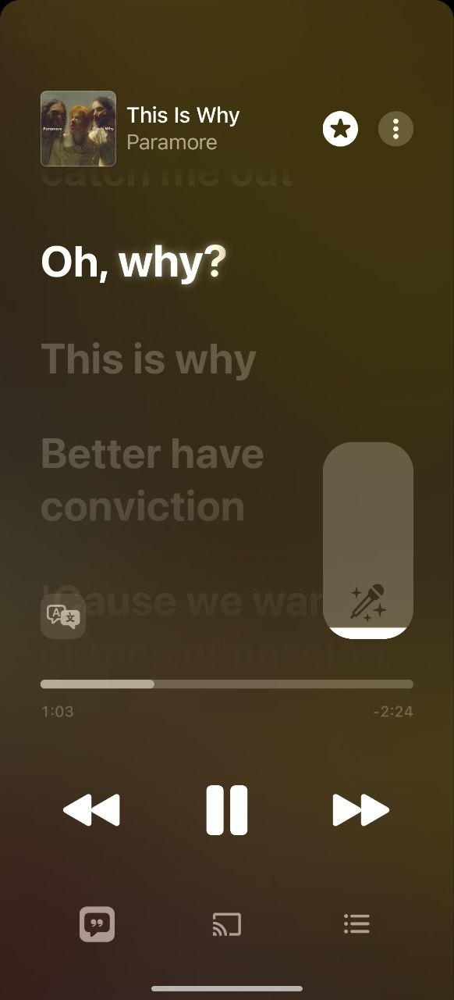
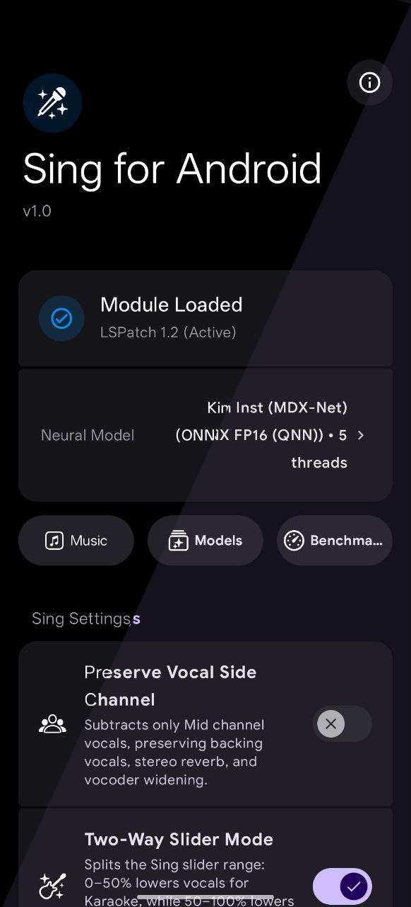
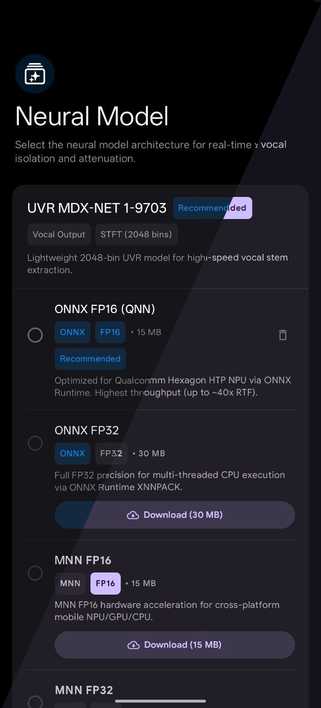

#  Sing for Android

[](https://www.gnu.org/licenses/gpl-3.0)
[](https://android.com)

**Sing for Android** is an Xposed module that attempts to bring Apple Music's iOS-exclusive **Sing Mode** on the official Android app. It hooks into the Apple Music audio pipeline to isolate, attenuate, or boost vocals on the fly with low latency and hardware acceleration support.

---

## Screenshots

| Apple Music (Sing Active) | Settings Screen | Neural Model Catalog |
|:---:|:---:|:---:|
|  |  |  |

---

## Features

- **Real-Time On-Device Stem Separation**: Separates vocals from backing tracks in real time during audio playback entirely locally, using whatever hardware accelerator you think is the best to use.
- **Hardware Acceleration**:
  - **Qualcomm Hexagon HTP / NPU**: Powered by ONNX Runtime with Qualcomm QNN Execution Provider for super high speed real time processing with low thermals and battery drain.
  - **OpenCL / Vulkan GPU & NNAPI**: Powered by Alibaba MNN for cross-platform GPU acceleration and NNAPI support.
  - **Multi-threaded CPU Fallback**: High-performance portable fallback with configurable thread.
- **Multiple Model to choose from**:
  - **MDX-Net** (Kim Inst, UVR 1-9703) in FP16 / FP32 precision.
  - **Apple Sing (Vi-NNet)** native reference engine.
- **Advanced Playback & Slider Controls**:
  - **Two-Way Slider**: 0%–50% attenuates vocals for karaoke singing; 50%–100% attenuates the instrumental track for acapella vocal isolation.
  - **Bypass all client/server-side limitations**: Enable Sing on all songs, even those iOS will refuse to work with, and allow the slider to go all the way down & up.
  - **Preserve Side Channel**: Keep backing vocals, stereo reverbs, and vocoder vocal effects in the audio mix.
- **Modern Expressive UI**:
  - Material 3 Expressive and dynamic **Material You** theming adapting to your wallpaper palette.

---

## Requirements

- **Android 11** or higher. 
- **Apple Music for Android** (v7.0.0-beta 1607+).
- **Xposed Environment**:
  - [Vector](https://github.com/JingMatrix/Vector) (Rooted with Magisk / KernelSU / whatever)
  - Or JingMatrix's [LSPatch](https://github.com/JingMatrix/LSPatch) fork (Non-root, embedded module mode).

---

## Installation & Setup

1. **Install Module**:
   - Download the latest APK release from [Releases](https://github.com/22cms/sing-for-android/releases).
   - Install the APK on your device.
2. **Enable in Xposed Manager**:
   - If using Vector: Open Vector, enable the **Sing for Android** module, and check **Apple Music** in its scope.
   - If using LSPatch: Patch the Apple Music APK with the Sing for Android module **in embedded mode** and with signature bypass mode 2.
3. **Configure Settings**:
   - Launch **Sing for Android** from your launcher (or long-press/right-click the Sing icon in Apple Music).
   - Select your preferred neural model and compute target in the app.
   - Run the built-in benchmark to verify that your hardware achieves realtime speeds (>1.0x Real-Time).

---

## Building from Source

### Prerequisites

- Android Studio Koala / Ladybug or command-line SDK tools.
- Android NDK (r25c+ to r28 recommended, set via `ANDROID_NDK_HOME` or installed via SDK manager).
- CMake 3.22.1+.
- Java 17+.

### 1. Clone with Submodules

This project uses [KissFFT](https://github.com/mborgerding/kissfft) as a submodule in `extern/kissfft`. Clone recursively or initialize the submodule:

```bash
# Clone the repository recursively
git clone --recursive https://github.com/22cms/sing-for-android.git
cd sing-for-android

# If already cloned without submodules:
git submodule update --init --recursive
```

### 2. Build libMNN with Hexagon HTP NPU & Vulkan

To keep the repository clean of large binary blobs, `libMNN.so` is built directly from source rather than checked into git. 

Run the automated MNN build script:

```bash
bash scripts/build_mnn.sh
```

This script will:
- Clone the upstream Alibaba MNN repository into `build-mnn/MNN/`.
- Apply project patches from `scripts/mnn_patches.patch` (enabling Qualcomm Hexagon HTP layout-aware transpose and crash-free NNAPI fallback).
- Download Qualcomm QNN SDK v2.37 dependencies into MNN's 3rdParty directory.
- Compile optimized `libMNN.so` with static STL (`c++_static`), Vulkan GPU, OpenCL, NNAPI, and QNN HTP NPU support for `arm64-v8a` and `armeabi-v7a`.
- Strip symbols and install the resulting shared libraries into `app/src/main/jniLibs/`.

### 3. Build Application APK

Once `libMNN.so` is built and the KissFFT submodule is initialized, build the APK using Gradle:

```bash
# Build Debug APK (arm64-v8a)
./gradlew assembleDebug

# Build Release APK
./gradlew assembleRelease
```

The resulting APK will be located under `app/build/outputs/apk/`.

---

## Third-Party Projects & Acknowledgements

- **[Microsoft ONNX Runtime](https://github.com/microsoft/onnxruntime)** & **[Qualcomm QNN](https://www.qualcomm.com/products/technology/processors/cloud-ai-100/neural-processing-sdk)**: Neural network runtime with Hexagon HTP execution provider.
- **[Alibaba MNN](https://github.com/alibaba/MNN)**: Lightweight cross-platform deep learning inference engine for mobile GPUs and NPUs.
- **[MDX-Net / Ultimate Vocal Remover](https://github.com/Anjok07/ultimatevocalremovergui)**: State-of-the-art vocal isolation architectures by Roman Solovyev et al. (Kuielab).
- **[KissFFT](https://github.com/mborgerding/kissfft)**: Fast Fourier Transform library by Mark Borgerding.
- **[Vector](https://github.com/JingMatrix/Vector) / [LSPatch](https://github.com/JingMatrix/LSPatch)**: Modern ART hooking framework and patcher.
- **[Apple SF Symbols](https://developer.apple.com/sf-symbols/)**: Iconography reference.

---

## License

This project is licensed under the [GNU General Public License v3.0](LICENSE).
Apple Music is a trademark of Apple Inc. This project is independent and not affiliated with or endorsed by Apple Inc.
